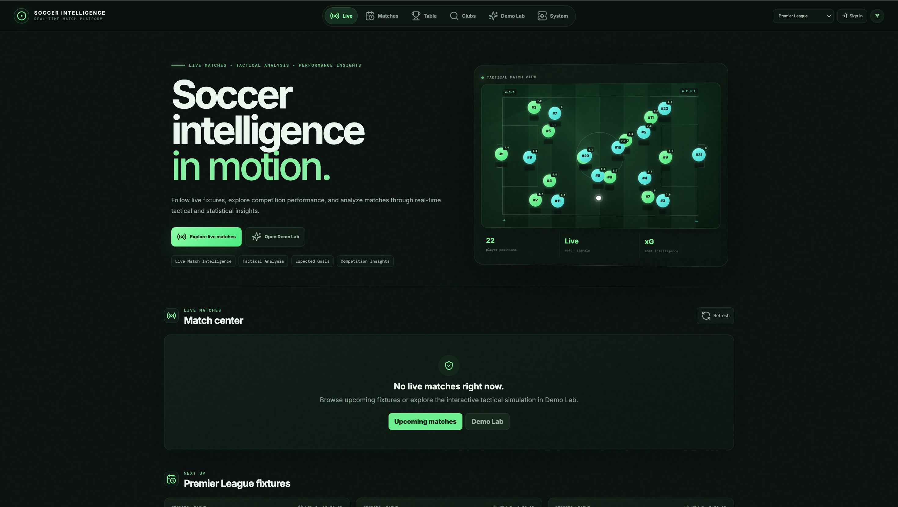
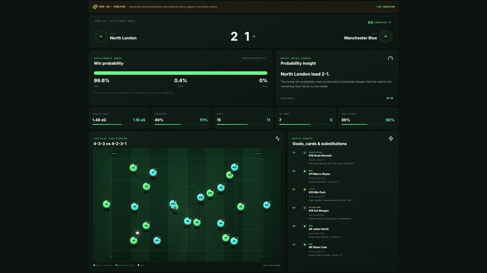
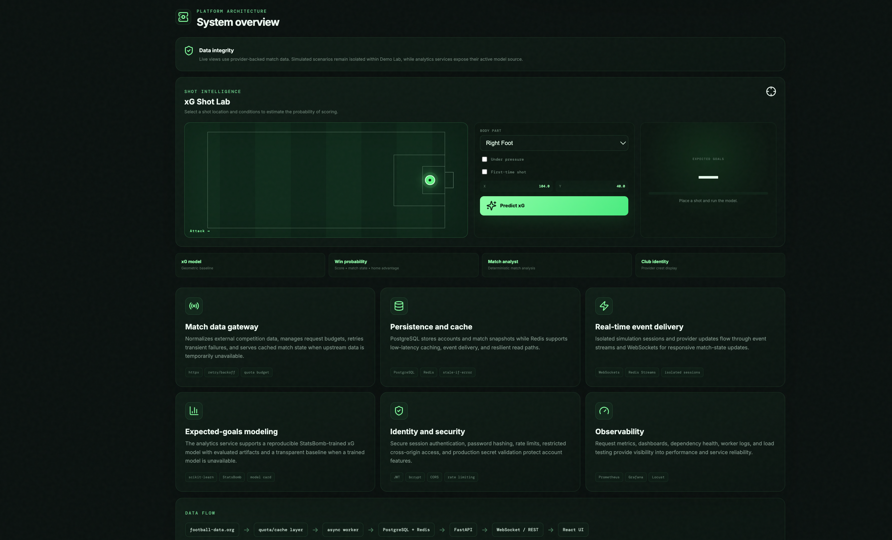
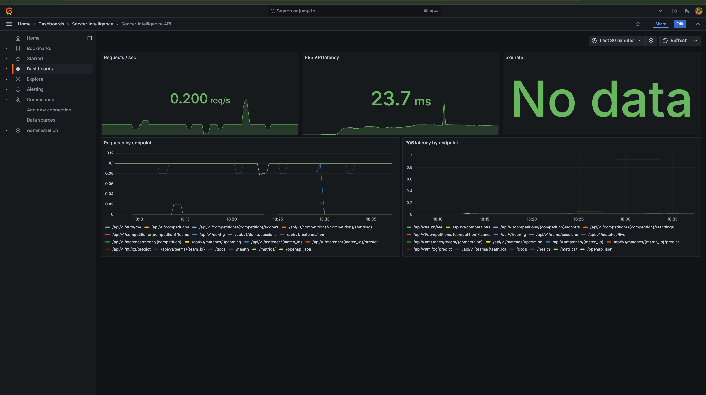

# Soccer Intelligence Platform

Soccer Intelligence Platform is a full-stack web application for viewing soccer matches, team information, league tables, match analytics, and tactical insights.

The project combines real soccer data with an interactive Demo Lab where users can explore a simulated 11 vs 11 match with player movement, events, and live statistics.

## Screenshots

### Home


### Demo Lab


### Match Analytics


### Monitoring


## Features

- Live and upcoming matches
- Recent results
- League standings
- Club and squad information
- Team crests with fallback badges
- Match details and score information
- Win, draw, and loss probability
- xG Shot Lab
- 11 vs 11 tactical Demo Lab
- Player names, jersey numbers, and positions
- Goals, assists, cards, and substitutions
- Animated player and ball movement
- User login and favorite clubs
- Real-time updates using WebSockets
- Monitoring with Prometheus and Grafana

## Tech Stack

### Frontend
- React
- TypeScript
- Vite

### Backend
- Python
- FastAPI
- WebSockets

### Database and Caching
- PostgreSQL
- Redis

### Data Science
- pandas
- scikit-learn
- StatsBomb Open Data

### Other Tools
- Docker
- GitHub Actions
- Prometheus
- Grafana

## How It Works

```text
Soccer Data API
      ↓
Backend Worker
      ↓
PostgreSQL + Redis
      ↓
FastAPI
      ↓
React Frontend
```

Real match information comes from football-data.org.

The Demo Lab uses simulated data so the interactive match features can still be explored when no real match is live.

## Run the Project

### 1. Open Terminal

Go to the project folder:

```bash
cd ~/Desktop/soccer_intelligence_platform
```

### 2. Create the environment file

```bash
cp .env.example .env
```

Add your football-data.org API key to `.env`:

```env
FOOTBALL_DATA_API_KEY=your_api_key
```

### 3. Start the project

```bash
make up
```

Then open:

- App: `http://localhost:5173`
- Backend API: `http://localhost:8000/docs`
- Grafana: `http://localhost:3000`
- Prometheus: `http://localhost:9090`

## xG Model

The project includes an expected-goals training pipeline using StatsBomb Open Data.

To train the model:

```bash
make train-xg
```

The trained model is then used by the xG Shot Lab when available.

## Testing

Run all tests with:

```bash
make test
```

## Data Sources

- football-data.org — match, team, competition, and standings data
- StatsBomb Open Data — data used for xG model training

## Notes

- Real match data depends on what is available from the soccer data provider.
- Demo Lab data is simulated and clearly labeled inside the application.
- API keys and `.env` files should never be uploaded to GitHub.
